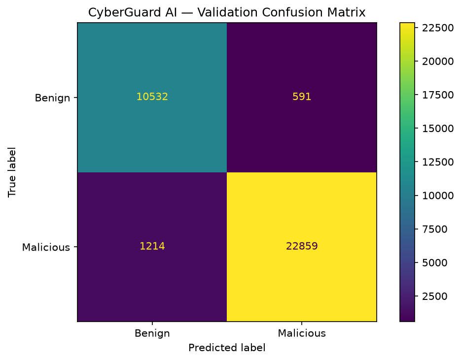
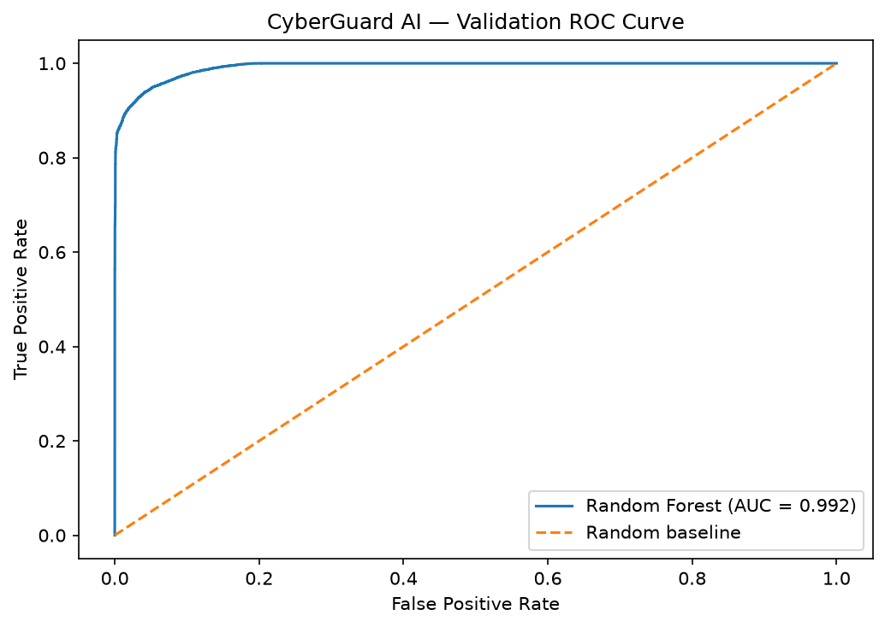
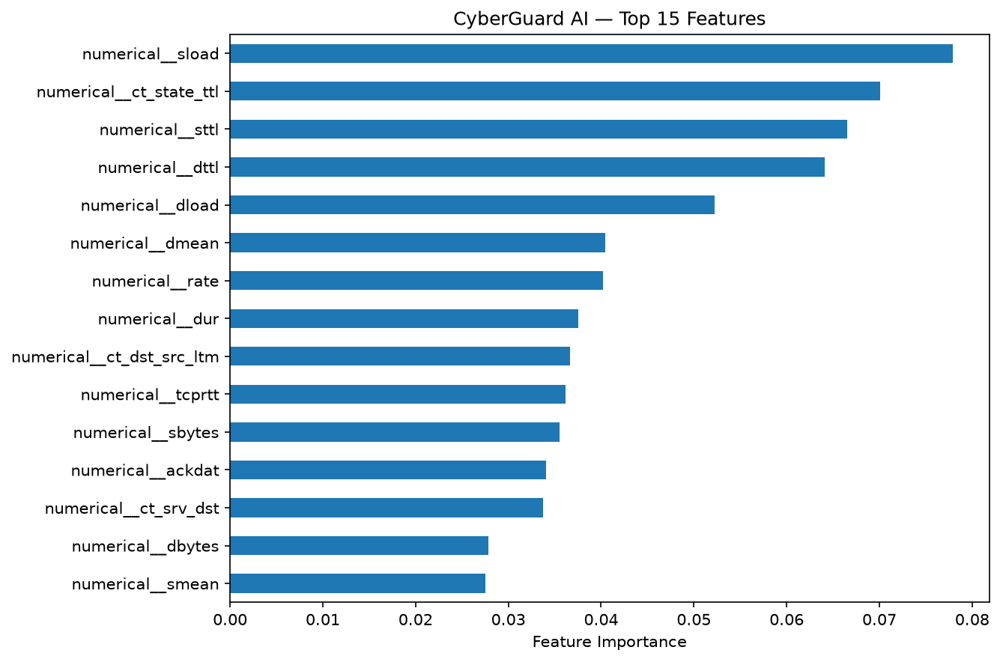

# CyberGuard AI

### Machine Learning for Network Intrusion Detection

**CyberGuard AI** is an educational Data Science and Machine Learning project that investigates whether historical network traffic can be classified as benign or malicious using supervised learning.

The project uses the **UNSW-NB15 dataset** to develop a reproducible classification pipeline, assess data quality, evaluate a Random Forest model, and examine the limitations of intrusion detection using historical network traffic.

> **Project disclaimer:** CyberGuard AI is an independent educational portfolio project. It uses a public research dataset and a simulated cybersecurity use case. It is not affiliated with a financial institution and is not a production-ready security system.

## 1. Project Overview

**Domain:** Cybersecurity, Data Science, Machine Learning  
**Problem Type:** Binary Classification  
**Dataset:** UNSW-NB15  
**Programming Language:** Python  
**Primary Model:** RandomForestClassifier  
**Development Environment:** Jupyter Notebook, Visual Studio Code  
**Version Control:** Git and GitHub  
**Project Management:** Scrumban

The objective is to analyze network traffic characteristics and train a model that predicts one of two classes:

- **0 — Benign:** Network traffic classified as normal.
- **1 — Malicious:** Network traffic classified as suspicious or attack-related.

The project follows an offline research workflow rather than a real-time detection architecture.

## 2. Problem Statement

Network intrusion detection is challenging because network traffic contains large amounts of heterogeneous data, including different protocols, connection states, traffic volumes, and communication patterns.

Manual examination of every connection is impractical at scale.

Machine Learning offers an approach for identifying statistical patterns associated with malicious traffic. However, model performance can be affected by class imbalance, duplicate observations, conflicting labels, dataset overlap, and differences between historical and real-world traffic.

**Research question:**

*Can a supervised Machine Learning model classify benign and malicious network traffic effectively using the UNSW-NB15 dataset, and what limitations affect the reliability of its evaluation?*

## 3. Project Objectives

- Investigate the UNSW-NB15 dataset and its features.
- Assess missing values, duplicates, conflicting labels, and data quality.
- Identify possible Data Leakage and Train/Test Overlap.
- Prepare numerical and categorical features for Machine Learning.
- Establish a DummyClassifier baseline.
- Train a RandomForestClassifier.
- Evaluate classification performance using appropriate metrics.
- Document limitations and ensure reproducibility.
- Communicate findings through technical documentation and visualizations.

## 4. Dataset

**Source:** [UNSW-NB15 — UNSW Research](https://research.unsw.edu.au/projects/unsw-nb15-dataset)

The dataset contains network traffic observations with features describing communication behaviour and associated classification labels.

| Dataset | Records |
|---|---:|
| Official Training Dataset | 175,341 |
| Official Test Dataset | 82,332 |
| Total | 257,673 |

The prepared CSV files contain 45 columns.

For Binary Classification:

- 42 columns are selected as Input Features.
- `label` is the Target Variable.
- `id` is excluded because it is an identifier.
- `attack_cat` is excluded to avoid potential Target Leakage.

The selected Input Features consist of 39 Numerical Features and three Categorical Features: `proto`, `service`, and `state`.

**Dataset distribution:** The original CSV files are not included in this GitHub repository. Users must obtain them from the dataset source and respect the applicable licensing, citation, and usage requirements.

## 5. Technology Stack

| Technology | Purpose |
|---|---|
| Python | Data processing and Machine Learning |
| pandas | Data manipulation and analysis |
| NumPy | Numerical operations |
| scikit-learn | Preprocessing, model training, and evaluation |
| Matplotlib | Data visualizations |
| Jupyter Notebook | Reproducible experiments |
| VS Code | Development environment |
| Git & GitHub | Version control and project documentation |

## 6. Machine Learning Workflow

The project is organized into the following stages:

1. **Dataset Research:** Investigate and select a suitable cybersecurity dataset.
2. **Data Quality Assessment:** Examine duplicates, missing values, labels, and feature distributions.
3. **Feature Selection:** Exclude identifiers and potentially leaking columns.
4. **Development Split:** Separate Training and Validation using GroupShuffleSplit.
5. **Preprocessing:** Apply One-Hot Encoding to categorical features.
6. **Baseline Model:** Evaluate a DummyClassifier.
7. **Model Training:** Train a RandomForestClassifier.
8. **Validation:** Measure performance on held-out development data.
9. **Test Evaluation:** Evaluate the fitted model on the official Test Dataset.
10. **Reporting:** Document metrics, error types, feature importance, and limitations.

### Model Configuration

The initial Random Forest uses:

| Hyperparameter | Value |
|---|---|
| `n_estimators` | 80 |
| `max_depth` | 18 |
| `min_samples_leaf` | 2 |
| `class_weight` | balanced_subsample |
| `random_state` | 42 |
| `n_jobs` | 4 |

This is an initial fixed configuration, not the result of an exhaustive Hyperparameter Search.

## 7. Model Evaluation Results

### Validation Performance

| Metric | Random Forest |
|---|---:|
| Accuracy | 94.87% |
| Precision | 97.48% |
| Recall | 94.96% |
| F1-score | **96.20%** |
| ROC-AUC | 0.9924 |

The Random Forest achieved a Validation F1-score of 96.20%, compared with approximately 81.23% for the most-frequent-class DummyClassifier baseline.

### Official Test Performance

| Metric | Random Forest |
|---|---:|
| Accuracy | 90.51% |
| Balanced Accuracy | 89.77% |
| Precision | 87.13% |
| Recall | **97.11%** |
| F1-score | **91.85%** |
| ROC-AUC | 0.9841 |

The model achieved high recall for malicious traffic within this historical dataset.

However, a Recall of 97.11% does not establish equivalent real-world detection performance. False Positives, dataset characteristics, and generalization limitations must also be considered.

The difference between Validation and Test performance suggests that the evaluation setting matters and warrants further investigation.

## 8. Data Quality Findings and Limitations

Data quality was a significant part of the project.

The investigation identified:

- **67,601 duplicate occurrences** in the Training Dataset when excluding the `id` column.
- **229 feature combinations** associated with conflicting binary labels.
- **940 Training Records** belonging to those conflicting groups.
- **8,541 Test Records (10.37%)** whose 42 Input Features exactly match combinations present in the original Training Dataset.
- **6,937 Test Records** with matching feature combinations in the subset actually used for model fitting.

These observations introduce important limitations.

In particular, feature overlap between Training and Testing can make evaluation results appear more optimistic. Matching Features do not necessarily establish that observations represent identical real-world connections.

Duplicates and conflicting labels were retained because the available evidence was insufficient to determine which observations, if any, should be corrected or removed.

The official Test Dataset was not used to fit the preprocessing pipeline or tune model hyperparameters.

A supplementary evaluation on Test Records without feature matches to the model-fitting subset is also documented.

For additional details, see [Data Cleaning Report](docs/data-cleaning-report.md) and [Model Evaluation Report](docs/model-evaluation-report.md).

## 9. Visualizations

### Validation Confusion Matrix



### Validation ROC Curve



### Top 15 Feature Importances



Feature importance values describe the fitted model's behaviour and should not be interpreted as causal explanations of malicious network activity.

## 10. Repository Structure

```text
cyberguard-ai/
├── README.md
├── .gitignore
├── requirements.txt
│
├── notebooks/
│   ├── 01_dataset_inspection.ipynb
│   ├── 02_data_cleaning.ipynb
│   └── 03_model_training.ipynb
│
├── docs/
│   ├── dataset-research.md
│   ├── data-dictionary.md
│   ├── technical-requirements.md
│   ├── technical-blueprint.md
│   ├── data-cleaning-report.md
│   └── model-evaluation-report.md
│
├── assets/
│   └── model_evaluation/
│       ├── validation_confusion_matrix.png
│       ├── validation_roc_curve.png
│       └── feature_importance.png
│
└── Data/
    └── Raw data/
        ├── UNSW_NB15_training-set.csv
        └── UNSW_NB15_testing-set.csv
```

The `Data/Raw data/` directory is a local input directory and is excluded from Git tracking.

## 11. Reproducibility

### Clone the Repository

```bash
git clone https://github.com/Juanita-HP/cyberguard-ai.git
cd cyberguard-ai
```

### Create a Virtual Environment

```bash
python3 -m venv .venv
source .venv/bin/activate
```

On Windows, the activation command differs.

### Install Dependencies

```bash
python -m pip install -r requirements.txt
```

The supplied `requirements.txt` captures the development environment's package versions and may contain platform-specific dependencies. The project was developed on macOS with Python 3.11.

### Download the Dataset

Obtain the prepared UNSW-NB15 Training and Testing CSV files from the official dataset source.

Place them in:

```text
Data/Raw data/
```

Required files:

```text
UNSW_NB15_training-set.csv
UNSW_NB15_testing-set.csv
```

### Run the Notebooks

Open the repository in VS Code with the Python and Jupyter extensions installed.

Select the project's `.venv` Python Kernel.

Run the notebooks in the following order:

1. `01_dataset_inspection.ipynb`
2. `02_data_cleaning.ipynb`
3. `03_model_training.ipynb`

The Model Training Notebook independently loads the original CSV files and reconstructs the preprocessing and development split, so it can also be executed directly.

Generated evaluation charts and the Model Evaluation Report are written to the repository's `assets/` and `docs/` directories.

## 12. Project Scope

### Included

- Historical network traffic analysis
- Data quality assessment
- Binary Classification
- Supervised Machine Learning
- Model evaluation
- Technical documentation
- Reproducible experiments

### Excluded

- Real-time network monitoring
- Live intrusion prevention
- Production deployment
- Banking infrastructure integration
- Automated incident response
- Claims of real-world cybersecurity certification

## 13. Future Improvements

Potential research extensions include:

- Further examination of duplicate records and label conflicts.
- External validation on independent network traffic datasets.
- Additional Baseline Models and controlled model comparisons.
- Threshold analysis to examine False Positive and False Negative trade-offs.
- Feature selection and computational efficiency studies.
- Model interpretability investigations.
- Production-readiness and security requirements analysis.

## 14. Key Takeaways

CyberGuard AI demonstrates how a structured Machine Learning workflow can be used to investigate network intrusion detection.

The Random Forest achieved an **Official Test F1-score of 91.85%** and a **Recall of 97.11%** for the Malicious class.

Beyond predictive performance, the project emphasizes data quality, evaluation integrity, transparency, and reproducibility.

A high model score is only meaningful when its assumptions and limitations are understood.

---

**Project Type:** Independent Data Science & Machine Learning Portfolio Project  
**Repository:** [CyberGuard AI on GitHub](https://github.com/Juanita-HP/cyberguard-ai)

*Built for learning, experimentation, and reproducible Machine Learning research.*

## 15. Dataset Attribution & References

CyberGuard AI uses the UNSW-NB15 dataset developed at UNSW Canberra. The original dataset creators retain their copyright.

The project is intended for independent, non-commercial educational research. The original dataset files are not redistributed through this repository.

**Official Dataset Source:** https://research.unsw.edu.au/projects/unsw-nb15-dataset

### Academic References

1. Moustafa, N., & Slay, J. (2015). *UNSW-NB15: A comprehensive data set for network intrusion detection systems (UNSW-NB15 network data set).* Military Communications and Information Systems Conference (MilCIS), IEEE.

2. Moustafa, N., & Slay, J. (2016). *The evaluation of Network Anomaly Detection Systems: Statistical analysis of the UNSW-NB15 dataset and the comparison with the KDD99 dataset.* Information Security Journal: A Global Perspective.

3. Moustafa, N., et al. (2017). *Novel geometric area analysis technique for anomaly detection using trapezoidal area estimation on large-scale networks.* IEEE Transactions on Big Data.

4. Moustafa, N., et al. (2017). *Big data analytics for intrusion detection system: Statistical decision-making using finite dirichlet mixture models.* Data Analytics and Decision Support for Cybersecurity, Springer.

5. Sarhan, M., Layeghy, S., Moustafa, N., & Portmann, M. (2020). *NetFlow Datasets for Machine Learning-Based Network Intrusion Detection Systems.* Big Data Technologies and Applications, Springer.

For commercial use or other uses not clearly covered by the published terms, permission should be clarified with the dataset authors.
