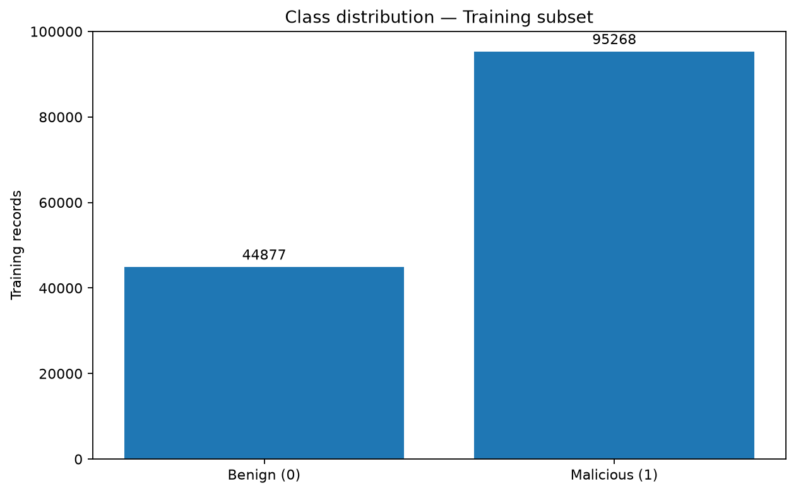
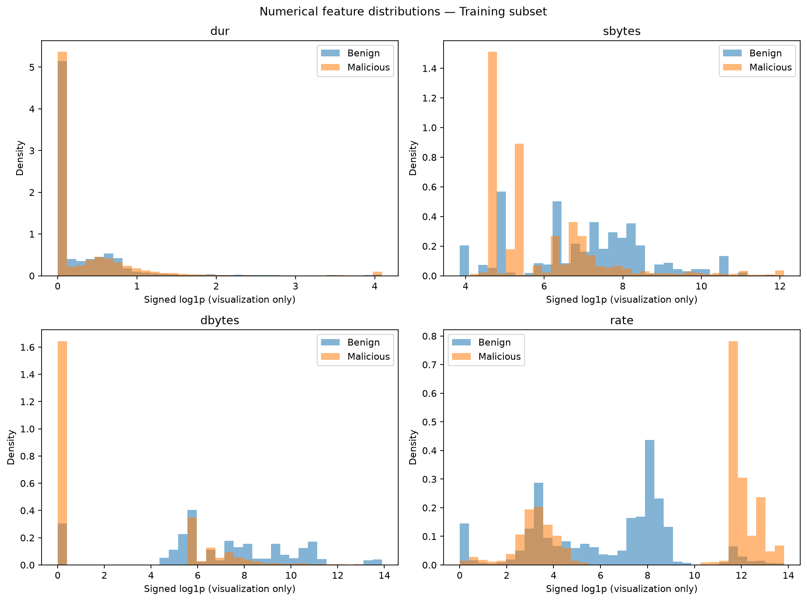
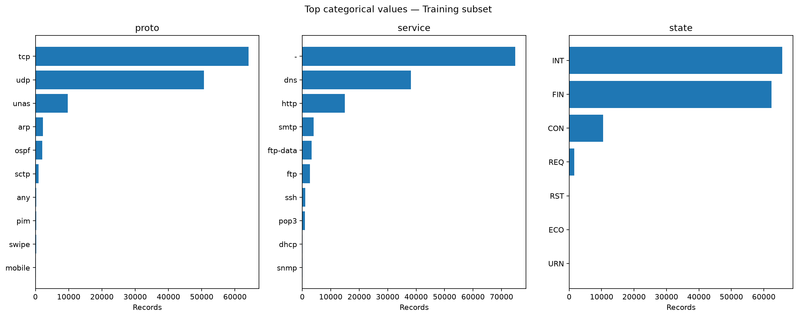
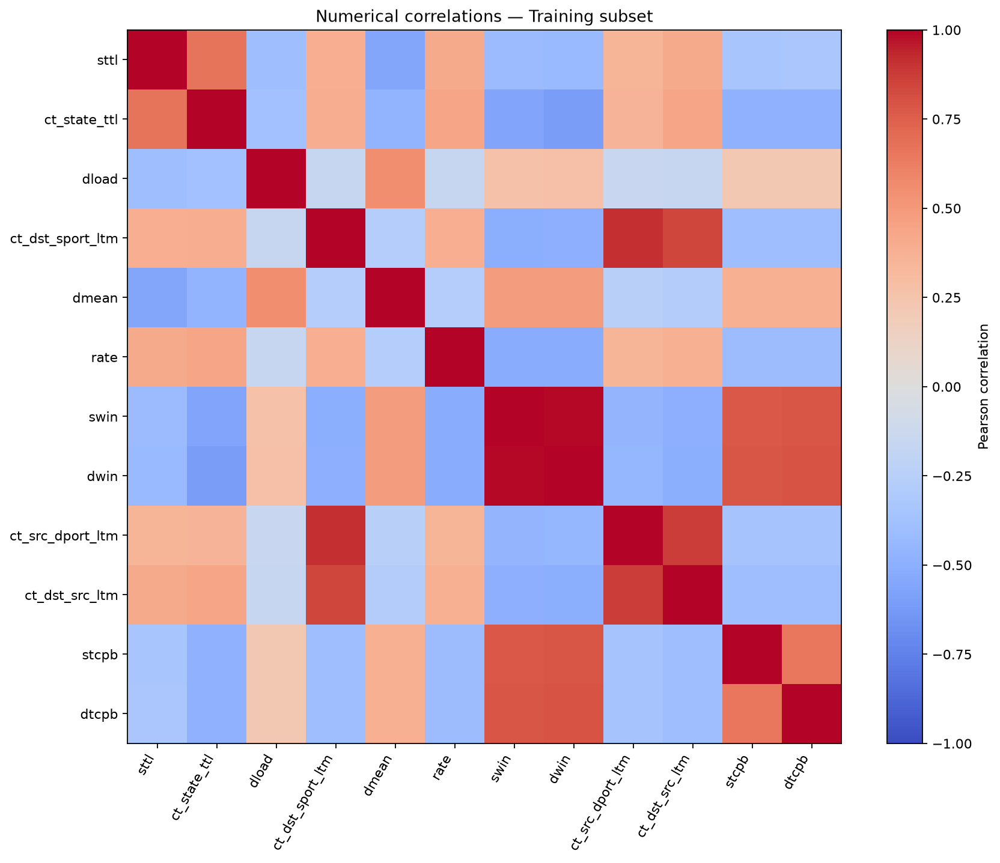
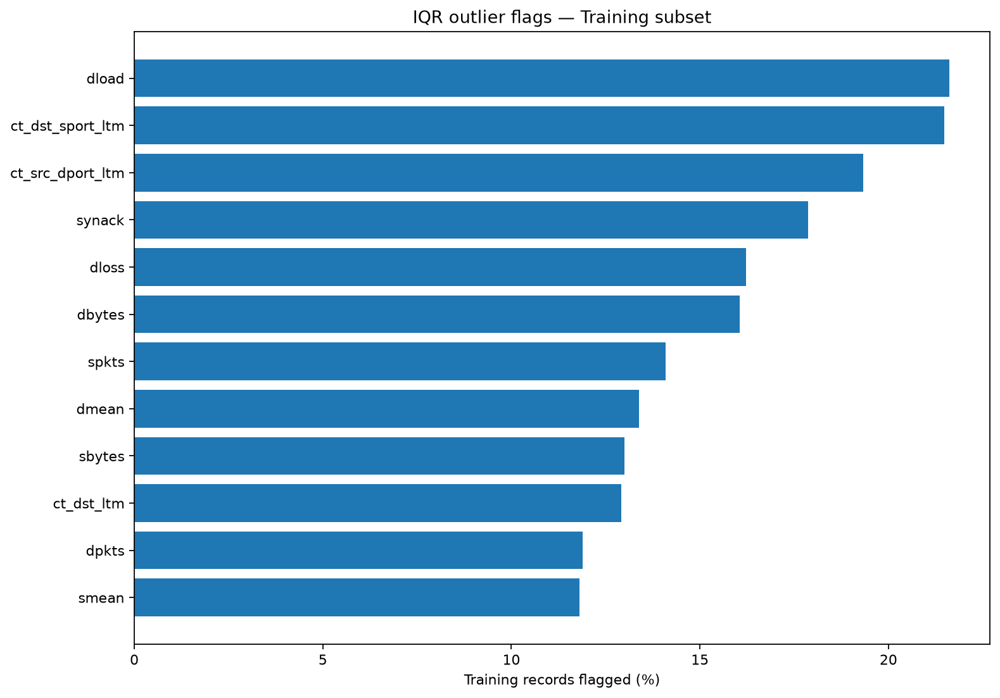

# CyberGuard AI — Exploratory Data Analysis Report

## 1. Scope
Exploratory analysis of the model-fitting portion of the official UNSW-NB15 training CSV.
The held-out validation subset and official test CSV are not analyzed here.
The training/validation split uses GroupShuffleSplit with the same settings as Task 10.

## 2. Dataset Summary
- Original official training rows: 175,341
- EDA training rows: 140,145
- Held-out validation rows: 35,196
- Selected input features: 42
- Numerical features: 39
- Categorical features: 3
- Missing cells (NaN): 0

## 3. Class Distribution
- Benign: 44,877
- Malicious: 95,268
- Malicious proportion: 67.98%

## 4. Numerical Distributions
Selected numerical features are displayed on a signed log1p scale, with sampled values clipped
at the 99.5th percentile of absolute magnitude for readability. Raw data is unchanged.

## 5. Categorical Features
Frequencies below describe the top values of each available categorical feature.
The literal '-' service value is preserved, not automatically considered missing.

### proto

| Value | Records |
|---|---:|
| tcp | 64,060 |
| udp | 50,650 |
| unas | 9,750 |
| arp | 2,274 |
| ospf | 2,034 |

### service

| Value | Records |
|---|---:|
| - | 74,859 |
| dns | 38,196 |
| http | 14,893 |
| smtp | 4,047 |
| ftp-data | 3,238 |

### state

| Value | Records |
|---|---:|
| INT | 65,671 |
| FIN | 62,340 |
| CON | 10,442 |
| REQ | 1,613 |
| RST | 67 |

## 6. Numerical Correlations
Ranked by absolute Pearson correlation with the target within the training subset.
Correlation is not causation or Random Forest feature importance.

| Feature | Correlation with label |
|---|---:|
| sttl | 0.6918 |
| ct_state_ttl | 0.5759 |
| dload | -0.3936 |
| ct_dst_sport_ltm | 0.3634 |
| dmean | -0.3417 |
| rate | 0.3378 |
| swin | -0.3355 |
| dwin | -0.3211 |
| ct_src_dport_ltm | 0.3108 |
| ct_dst_src_ltm | 0.3075 |
| stcpb | -0.2551 |
| dtcpb | -0.2529 |

## 7. IQR Outlier Analysis
Flags indicate values outside Q1 − 1.5×IQR or Q3 + 1.5×IQR.
Features with IQR=0 are excluded from this outlier estimate.

| Feature | Flagged records (%) |
|---|---:|
| dload | 21.62% |
| ct_dst_sport_ltm | 21.48% |
| ct_src_dport_ltm | 19.34% |
| synack | 17.87% |
| dloss | 16.22% |
| dbytes | 16.06% |
| spkts | 14.10% |
| dmean | 13.38% |
| sbytes | 13.00% |
| ct_dst_ltm | 12.92% |
| dpkts | 11.89% |
| smean | 11.80% |

## 8. Interpretation and Limitations
- This historical dataset is not representative of every real-world network.
- Labels and observations may contain duplicates or inconsistencies.
- Extreme feature values may be valid traffic, not necessarily data errors.
- No records were removed based on these EDA visualizations.
- The previously trained model was NOT adjusted using these retrospective findings.
- Prior validation/test metrics are unchanged; known Train/Test overlap remains a limitation.

## 9. Conclusion
This EDA documents class balance, numerical and categorical distributions,
correlation structure, and outlier flags using training data only.
