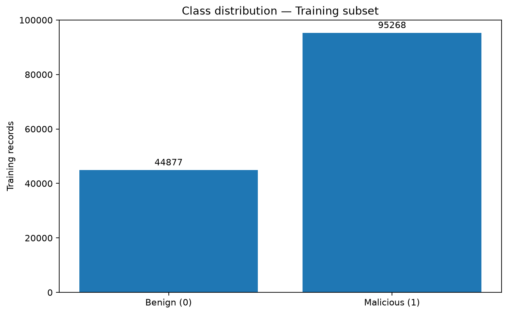
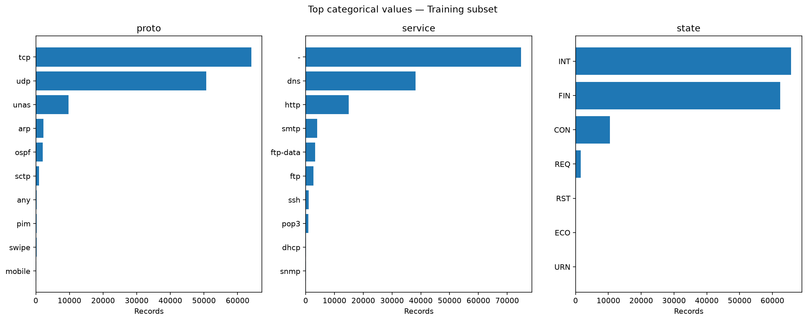
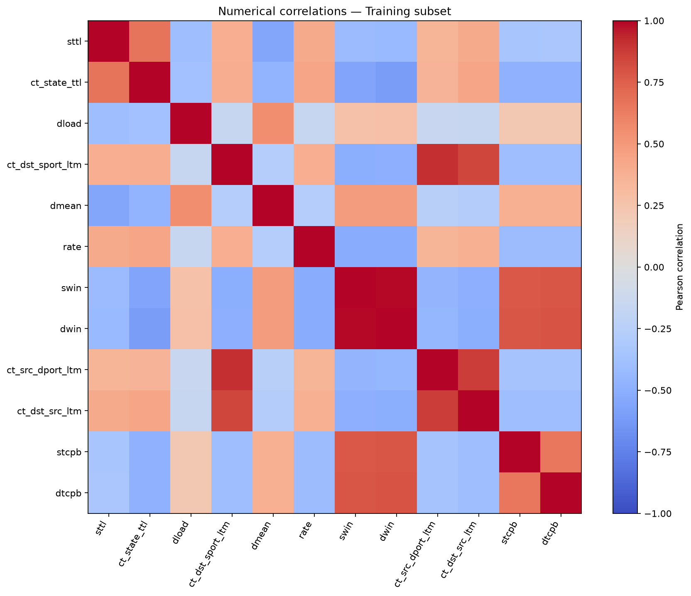
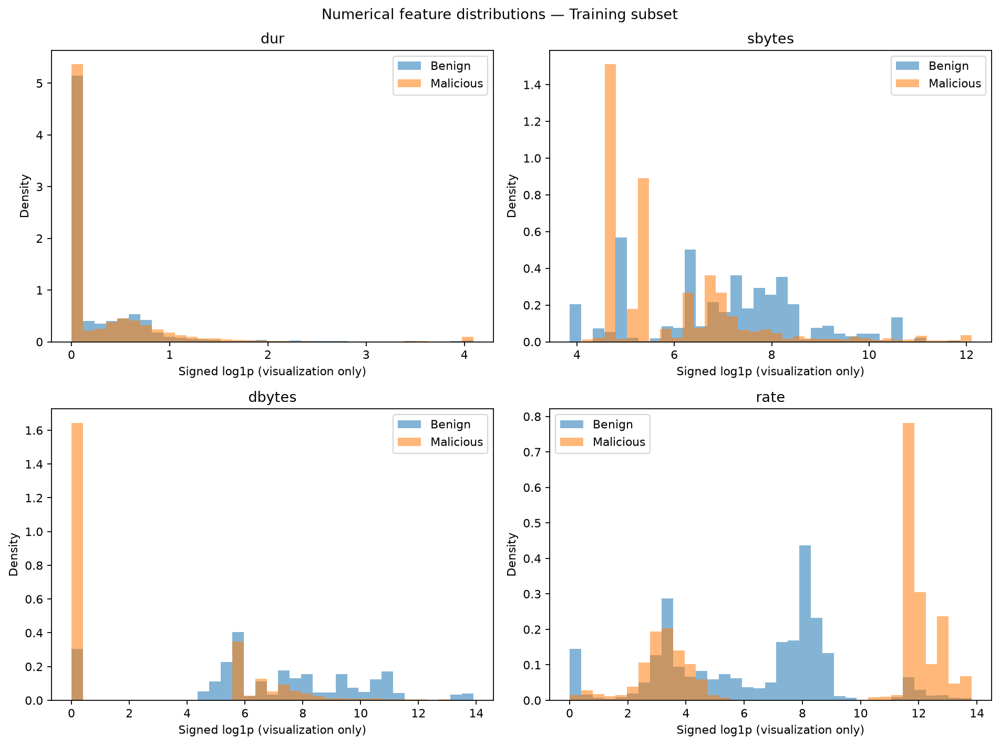
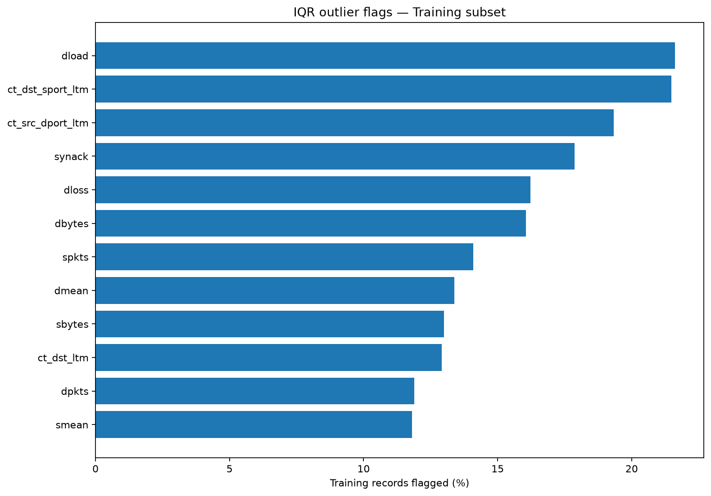
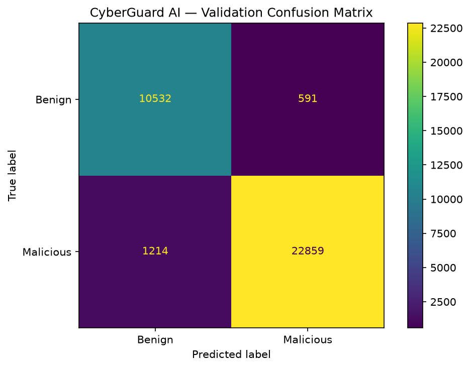
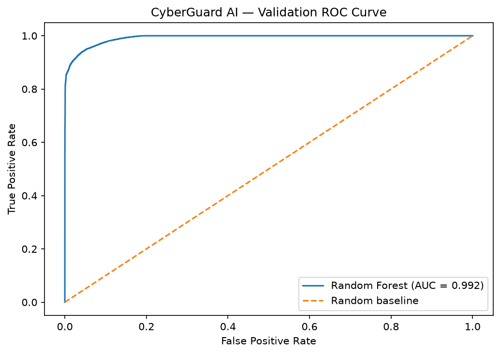
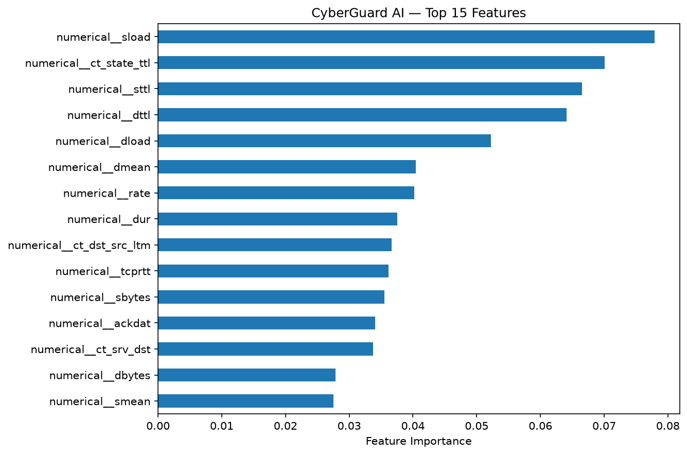

# CyberGuard AI — Final Project Report

**Project:** Machine Learning for Network Intrusion Detection  
**Type:** Independent educational Data Science / Machine Learning research  
**Dataset:** UNSW-NB15 (prepared training and testing CSV files)  
**Repository:** https://github.com/Juanita-HP/cyberguard-ai  
**Project task:** Task 11 — Final Report & Presentation

> **Scope notice:** CyberGuard AI is an offline educational project using historical network traffic. It is not a live intrusion detection product, a certified security tool, or a project affiliated with a financial institution.

## Executive Summary

CyberGuard AI investigates whether a supervised Machine Learning model can distinguish benign from malicious network traffic in the UNSW-NB15 dataset. The project covers dataset inspection, data quality assessment, preprocessing, retrospective Exploratory Data Analysis (EDA), baseline comparison, Random Forest training, and held-out evaluation. On the official Test Dataset, the model achieved **90.51% accuracy, 87.13% precision, 97.11% recall, 91.85% F1-score, and 0.9841 ROC-AUC** for the malicious class. A supplementary analysis of test records without feature matches to the actual model-fitting subset achieved **91.13% F1-score**.

Data quality is a central finding: duplicates, conflicting labels, and exact feature matches between official training and test records introduce uncertainty about generalization. These results describe performance on a historical research dataset, **not expected performance on live networks**.

## 1. Problem Statement and Objectives

Network connections differ in protocols, duration, packet counts, volumes, and traffic states. A supervised classification approach can identify statistical distinctions between records labelled as benign (0) and malicious (1), but evaluation quality matters as much as prediction quality.

**Research question:** How well can a Random Forest distinguish benign from malicious records in UNSW-NB15, and what data-quality and evaluation limitations should accompany its reported results?

**Objectives:**

1. Investigate the structure and limitations of the prepared UNSW-NB15 files.
2. Inspect duplicates, conflicting labels, missing cells, and Train/Test feature overlap.
3. Prepare a consistent group-aware development Train/Validation Split.
4. Describe class balance, numerical and categorical distributions, correlations, and outliers.
5. Train a simple baseline and a Random Forest classifier without fitting preprocessing on validation or test records.
6. Evaluate Accuracy, Balanced Accuracy, Precision, Recall, F1-score, ROC-AUC, and classification errors.
7. Report results transparently for a portfolio audience.

## 2. Dataset and Data Quality

The project uses the two prepared UNSW-NB15 CSV files:

| Partition | Number of records |
|---|---:|
| Official Training CSV | 175,341 |
| Official Test CSV | 82,332 |
| Combined | 257,673 |

There are **42 selected input features:** 39 numerical and 3 categorical (`proto`, `service`, `state`). The target is `label`, with **0 = Benign** and **1 = Malicious**. `id` is excluded as an identifier; `attack_cat` is excluded to avoid potential Target Leakage in binary classification.

### Data quality findings

| Finding | Observed result |
|---|---:|
| Missing values (`NaN`) in the official Training CSV | 0 |
| Duplicate occurrences excluding `id` in official training | 67,601 |
| Feature combinations with contradictory binary labels | 229 groups |
| Training rows in those conflicting-label groups | 940 |
| Official Test rows matching feature combinations in full official training | 8,541 (10.37% of test) |
| Official Test rows matching feature combinations used for model fitting | 6,937 |

Duplicate observations and conflicting labels were documented, **not automatically deleted or relabelled**. Equal feature vectors do not prove that the underlying network connections were identical. However, these matches limit how confidently a held-out test score can be interpreted as evidence of new-data generalization.

See [Data Cleaning Report](data-cleaning-report.md) for the original audit.

## 3. Development Split and Preprocessing

A `GroupShuffleSplit` with `test_size=0.20` and `random_state=42` separates the official Training CSV into a **140,145-row model-fitting subset** and a **35,196-row validation subset**. Identical combinations of selected input features are grouped so that no complete feature group appears in both development partitions.

The preprocessing Pipeline passes numerical features through unchanged and applies `OneHotEncoder(handle_unknown="ignore")` to the categorical features. Its fitted transformations are learned only from the model-fitting subset, producing **192 encoded features**. The official Test CSV is held out from fitting and preprocessing decisions.

## 4. Exploratory Data Analysis (Task 9)

The dedicated EDA notebook analyzes **only the 140,145 model-fitting records**, excluding the development validation records and official test records. The EDA was completed retrospectively after the initial model work and **was not used to tune or retrain the reported Random Forest**.

### Class distribution

| Class | Training-subset records | Share |
|---|---:|---:|
| Benign (0) | 44,877 | 32.02% |
| Malicious (1) | 95,268 | 67.98% |

The model-fitting data are imbalanced toward the malicious class. This is also why a majority-class baseline can obtain seemingly reasonable Accuracy or F1-score while providing no discrimination between the two classes.

### Categorical patterns

- `proto` is led by `tcp` (64,060 records) and `udp` (50,650 records).
- `service` most often contains the literal `-` (74,859 records), followed by `dns` (38,196). That literal category was not silently converted to a missing value.
- `state` is led by `INT` (65,671 records) and `FIN` (62,340 records).

### Numerical correlations

The strongest absolute **Pearson correlations with the binary label** in the EDA Training Split include:

| Feature | Pearson correlation with `label` |
|---|---:|
| `sttl` | +0.6918 |
| `ct_state_ttl` | +0.5759 |
| `dload` | -0.3936 |
| `ct_dst_sport_ltm` | +0.3634 |

These are **descriptive linear associations**, not causal effects and not the same measure as Random Forest feature importance.

### Numerical distributions and outlier flags

Numerical feature histograms use a signed logarithmic display transformation to make skewed values more readable; the source dataset is not changed. Under the standard IQR rule, **21.62%** of records are flagged as extreme for `dload`, **21.48%** for `ct_dst_sport_ltm`, and **19.34%** for `ct_src_dport_ltm`. An IQR flag does not automatically indicate bad data or an attack.

See [EDA Report](eda-report.md) for full frequencies, correlations, and outlier summaries.

## 5. Model Training

**Baseline:** `DummyClassifier(strategy="most_frequent")`.

**Main model:** `RandomForestClassifier(n_estimators=80, max_depth=18, min_samples_leaf=2, class_weight="balanced_subsample", random_state=42, n_jobs=4)` inside the preprocessing Pipeline.

These are initial fixed settings, **not the result of an exhaustive hyperparameter search**.

## 6. Model Evaluation

All classification metrics below take **Malicious (1)** as the positive class.

| Evaluation | Accuracy | Balanced Accuracy | Precision | Recall | F1-score | ROC-AUC |
|---|---:|---:|---:|---:|---:|---:|
| Dummy Baseline — Validation | 68.40% | 50.00% | 68.40% | 100.00% | 81.23% | 0.5000 |
| Random Forest — Validation | 94.87% | 94.82% | 97.48% | 94.96% | 96.20% | 0.9924 |
| **Random Forest — Official Test** | **90.51%** | **89.77%** | **87.13%** | **97.11%** | **91.85%** | **0.9841** |
| Random Forest — Test Without Model-Fit Feature Overlap | 90.11% | 89.75% | 86.15% | 96.71% | 91.13% | 0.9820 |

### Official Test confusion matrix

| Actual / Predicted | Predicted Benign | Predicted Malicious |
|---|---:|---:|
| Actual Benign | 30,499 (TN) | 6,501 (FP) |
| Actual Malicious | 1,312 (FN) | 44,020 (TP) |

The main model correctly identified a large fraction of labelled malicious records in the historical Test Dataset. At the same time, **6,501 benign records were classified as malicious**. High Recall therefore must be read alongside Precision, False Positives, and the evaluation context.

### Overlap sensitivity

Of the 82,332 official Test records, **6,937** have complete selected feature combinations that occur in the *actual model-fitting subset*. Excluding those matching records leaves **75,395** Test observations and yields **91.13% F1-score**. This is a useful sensitivity check, but **not an independent external benchmark**, and it does not resolve every possible source of bias.

See [Model Evaluation Report](model-evaluation-report.md) for the original evaluation record.

## 7. Interpretation, Limitations, and Responsible Use

- The dataset represents historical research traffic and may not represent contemporary or future networks.
- The official Training and Test files have measurable complete-feature overlap.
- Original duplicates and conflicting labels were retained because the project did not have an independently justified correction rule.
- Class distribution is unbalanced toward malicious records in the model-fitting subset.
- IQR outlier flags, correlations, and impurity-based feature importance are **not causal evidence**.
- No external dataset, live network, deployment, or operational False Positive cost evaluation was used.
- EDA findings were retrospective and **did not change the already reported model**.
- Execution from a completely fresh, unrelated environment has not been independently verified.

Consequently, the reported percentages are **offline evaluation results**, not guaranteed real-world detection rates.

## 8. Reproducibility

1. Clone the [CyberGuard AI repository](https://github.com/Juanita-HP/cyberguard-ai).
2. Create a Python 3.11 virtual environment and install `requirements.txt`.
3. Obtain the prepared UNSW-NB15 CSVs from [UNSW Research](https://research.unsw.edu.au/projects/unsw-nb15-dataset) under the applicable dataset usage terms.
4. Place `UNSW_NB15_training-set.csv` and `UNSW_NB15_testing-set.csv` under `Data/Raw data/` in the repository. The raw data files are intentionally excluded from Git.
5. Open and run `notebooks/01_dataset_inspection.ipynb` and `notebooks/02_data_cleaning.ipynb` for dataset inspection/preparation.
6. Run `notebooks/04_exploratory_data_analysis.ipynb` for Task 9 EDA figures and `docs/eda-report.md`. It uses the development training subset only.
7. Run `notebooks/03_model_training.ipynb` for baseline, Random Forest, and held-out evaluation. It independently reconstructs the development split. The EDA notebook was not used to adjust the original training decisions.

## 9. Conclusion and Future Work

CyberGuard AI demonstrates an end-to-end, documented Machine Learning research workflow that connects network traffic classification with responsible evaluation. **The Official Test F1-score was 91.85%**, while a supplementary no-model-fit-feature-overlap subset produced **91.13% F1-score**. The most important learning is that credible data science requires attention to data quality, leakage risks, and transparent model limitations—not just headline metrics.

Potential extensions include independent external validation, decision threshold analysis, explicit False Positive cost assessment, robustness evaluation, and more controlled model comparisons. These remain **future work**, not completed project capabilities.

## Sources and Further Reading

- [UNSW-NB15 official dataset page](https://research.unsw.edu.au/projects/unsw-nb15-dataset)
- [Repository README and academic references](https://github.com/Juanita-HP/cyberguard-ai#15-dataset-attribution--references)
- [Dataset Research](dataset-research.md)
- [Data Cleaning Report](data-cleaning-report.md)
- [EDA Report](eda-report.md)
- [Model Evaluation Report](model-evaluation-report.md)

*This report integrates the already published Tasks 8, 9, and 10. It does not represent additional model training or new experimental validation.*
