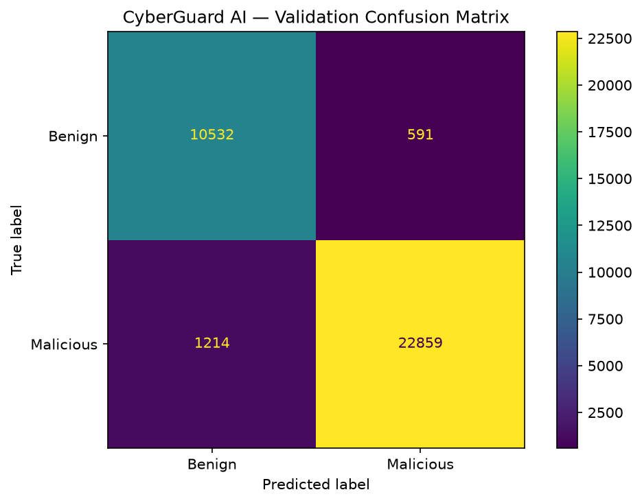
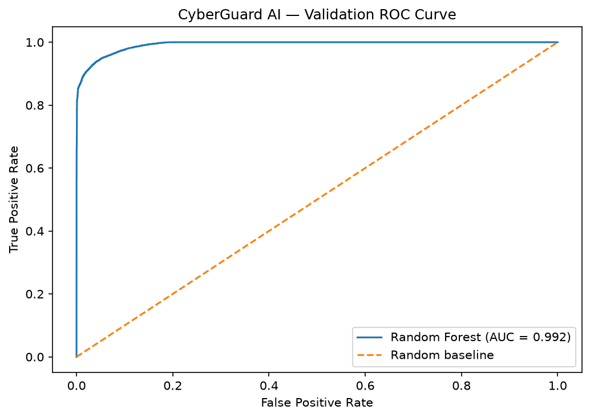
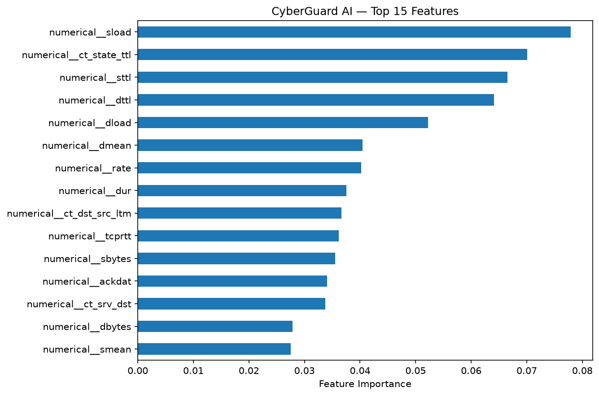

# CyberGuard AI — Model Training & Evaluation

## 1. Objective

Train and evaluate a supervised Machine Learning
model for binary network traffic classification.

- Benign: 0
- Malicious: 1

This is an educational offline research project,
not a production cybersecurity detection system.

## 2. Dataset

- Dataset: UNSW-NB15
- Official Training Records: 175,341
- Official Test Records: 82,332
- Input Features: 42
- Numerical Features: 39
- Categorical Features: 3
- Encoded Features: 192

Excluded: `id` and `attack_cat`.

## 3. Development Split

- Method: GroupShuffleSplit
- Random State: 42
- Model Training Records: 140,145
- Validation Records: 35,196
- Shared Feature Groups: 0

The Random Forest was fitted on the development
Training subset, rather than all records in the
official Training CSV.

## 4. Preprocessing

Numerical Features:
- Passthrough

Categorical Features:
- OneHotEncoder
- Unknown categories ignored

Preprocessing was fitted only on X_train.

## 5. Models

### Baseline

DummyClassifier:
- Strategy: most_frequent

### Random Forest

RandomForestClassifier:
- n_estimators: 80
- max_depth: 18
- min_samples_leaf: 2
- class_weight: balanced_subsample
- random_state: 42
- n_jobs: 4

These were initial fixed settings.
No hyperparameter search was performed.

## 6. Evaluation Metrics

Positive class: Malicious (1).

| Evaluation | Accuracy | Balanced Accuracy | Precision | Recall | F1-score | ROC-AUC |
|---|---:|---:|---:|---:|---:|---:|
| Baseline Validation | 0.6840 | 0.5000 | 0.6840 | 1.0000 | 0.8123 | 0.5000 |
| Random Forest Validation | 0.9487 | 0.9482 | 0.9748 | 0.9496 | 0.9620 | 0.9924 |
| Random Forest Official Test | 0.9051 | 0.8977 | 0.8713 | 0.9711 | 0.9185 | 0.9841 |
| Test Without Model-Fit Overlap | 0.9011 | 0.8975 | 0.8615 | 0.9671 | 0.9113 | 0.9820 |

Validation was used to assess the model during
development.

The fitted Random Forest was evaluated on the
official Test Dataset without retraining.

The official Test results must not be used to
select new hyperparameters.

## 7. Official Test Confusion Matrix

- True Negatives: 30,499
- False Positives: 6,501
- False Negatives: 1,312
- True Positives: 44,020

## 8. Train/Test Feature Overlap

- Matches against the full official Training set: 8,541
- Matches against the model fitting subset: 6,937
- Test records without fitting-set feature matches: 75,395

The full official Training/Test overlap was
previously verified with exact feature comparisons
during Phase 5.

Identical features do not necessarily mean
identical real-world network connections.

The non-overlapping Test evaluation is supplementary.

## 9. Top 10 Feature Importances

| Feature | Importance |
|---|---:|
| numerical__sload | 0.0779 |
| numerical__ct_state_ttl | 0.0701 |
| numerical__sttl | 0.0665 |
| numerical__dttl | 0.0641 |
| numerical__dload | 0.0522 |
| numerical__dmean | 0.0405 |
| numerical__rate | 0.0402 |
| numerical__dur | 0.0376 |
| numerical__ct_dst_src_ltm | 0.0366 |
| numerical__tcprtt | 0.0362 |

These are impurity-based model importance scores,
not causal explanations.

## 10. Visualizations

## 11. Limitations

- Historical network traffic, not live data.
- Original Duplicate Records retained.
- Conflicting Labels not automatically corrected.
- Class imbalance exists.
- Train/Test feature overlap exists.
- Evaluation may not reflect real-world performance.
- The model has not been deployed or externally validated.

## 12. Next Steps

- Review False Positives and False Negatives.
- Improve portfolio documentation.
- Present findings and limitations.
- Consider external validation on another dataset.
