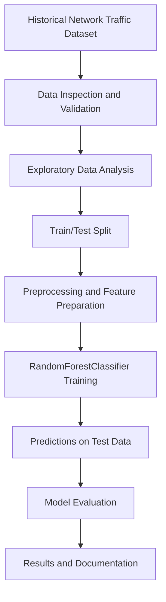

# CyberGuard AI — Technical Blueprint

**Version:** 1.0
**Status:** Draft — Pending Dataset Selection
**Project Type:** Educational Data Science and Machine Learning

## 1. Architecture Overview

CyberGuard AI is an offline Machine Learning pipeline designed to classify historical network traffic as Benign or Malicious.

The system does not perform live monitoring, automated incident response, or production intrusion detection.

## 2. Machine Learning Pipeline

Preprocessing steps that learn parameters from data must be fitted on the training subset only. The test subset must remain separate from model training and tuning.

## 3. Core Components

### Data Layer
- Historical labeled network traffic dataset
- pandas DataFrames
- Data validation and cleaning

### Analysis Layer
- Exploratory Data Analysis (EDA)
- Descriptive statistics
- Data visualizations

### Machine Learning Layer
- Binary target labels: Benign (0), Malicious (1)
- Train/test split
- Feature preprocessing
- RandomForestClassifier
- DummyClassifier baseline comparison

### Evaluation Layer
- Precision
- Recall
- F1-score
- Confusion Matrix
- ROC-AUC when appropriate

### Documentation Layer
- Reproducible Jupyter Notebook
- GitHub README
- Technical Requirements Document
- Technical Blueprint
- Portfolio presentation

## 4. Technology Stack

- **Language:** Python
- **Development:** VS Code and Jupyter Notebook
- **Data Processing:** pandas and NumPy
- **Machine Learning:** scikit-learn
- **Visualization:** Matplotlib and/or Plotly
- **Version Control:** Git and GitHub
- **Project Management:** GitHub Projects using Scrumban

## 5. Data Flow

1. Import a labeled historical dataset.
2. Inspect its structure and data quality.
3. Perform exploratory analysis.
4. Separate features and binary target labels.
5. Create training and testing subsets.
6. Fit preprocessing on training data and apply it consistently.
7. Train the baseline classification model.
8. Generate predictions using test data.
9. Evaluate classification performance.
10. Document results, limitations, and recommendations.

## 6. Expected Deliverables

- Clean and reproducible Jupyter Notebook
- EDA charts and analysis
- Binary Classification model
- Evaluation metrics and interpretation
- Documented GitHub repository
- Short portfolio presentation

## 7. Design Constraints

- Offline historical data only
- Binary Classification for Version 1.0
- No paid cloud infrastructure required
- No production deployment
- No real-time network monitoring
- Dataset-specific design decisions will be finalized after dataset selection

## 8. Future Enhancements

Potential Version 2.0 improvements include Multiclass Classification, additional algorithms, and more advanced model evaluation.
